  

  

  
  
  
  

 

  

---

## 🧑‍💻 About Me

- 🏢 Founder of **[Jambrs](https://jambrs.ir)**: I code, lead a 15+ person team, and mentor developers
- ⚙️ I build products **from 0 to 100**: backend logic, database design, frontend, hosting, deployment
- 🛡️ Into **cybersecurity and penetration testing**, because secure comes first
- 🎓 Taught **PHP/MySQL**, **HTML/CSS/JS**, and **English** to teenagers and young adults
- 📈 Leveling up right now: **Laravel · React · Next.js · TypeScript**
- 😄 Computer engineering student who claims he doesn't study, and ships anyway

---

## ⚡ Skills

  

   
  

---

## 🚀 Featured Projects

| Project | What it is | Stack |
|---|---|---|
| 🍽️ **[PersianMenu](https://persianmenu.ir)** | SaaS for cafes, restaurants & tea houses: pick a plan, build an online menu with a QR code | HTML · CSS · JS · PHP |
| 🏢 **[Jambrs](https://jambrs.ir)** | Website of my software company | HTML · CSS · JS · PHP |
| 🚗 **[MZ Clinic](https://mzclinic.ir)** | Service website for a car clinic (backend + hosting) | PHP |
| 🍬 **[Sepahan Tak](https://sepahantak.ir)** | Online store for a specialty Persian sweets shop (backend + hosting) | PHP |
| 💇 **[Elham Davari Hair](https://elhamdavarihair.ir)** | Website for a hair salon (backend + hosting) | PHP |

---

## 📊 GitHub Stats

  

---

## 🌐 Let's Connect

  
  
  
  
  
  

 

  

<i>"Every line of code is a chance to learn something you didn't know yesterday."</i>

